# 📷 Axl Rent - Aplikasi Penyewaan Kamera Android

[](https://kotlinlang.org/)
[](https://developer.android.com/jetpack/compose)
[](https://firebase.google.com/)
[](https://developer.android.com)

**Axl Rent** adalah aplikasi penyewaan kamera berbasis **Android Native** modern yang dibangun menggunakan **Jetpack Compose** dan **Firebase**. Aplikasi ini dirancang untuk menyelesaikan kesulitan fotografer pemula, kreator konten, maupun masyarakat umum dalam mencari, memilih, dan menyewa perangkat kamera serta aksesorinya secara cepat, transparan, dan terintegrasi secara digital.

---

## 📱 Galeri Antarmuka Aplikasi (UI Showcase)

### 1. Onboarding, Otentikasi & Beranda
<div align="center">
  <table>
    <tr>
      <td align="center"><b>Splash Screen</b></td>
      <td align="center"><b>Onboarding Screen</b></td>
      <td align="center"><b>Login Akun</b></td>
      <td align="center"><b>Beranda & Katalog</b></td>
    </tr>
    <tr>
      <td>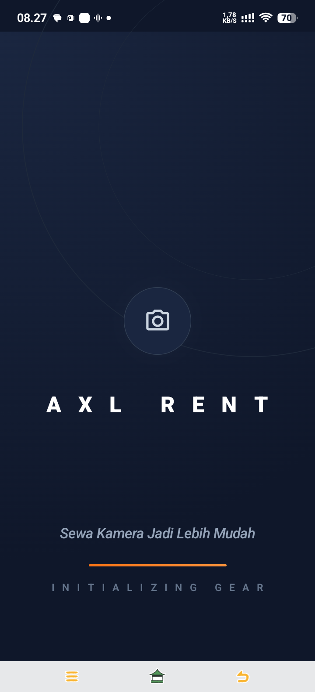</td>
      <td>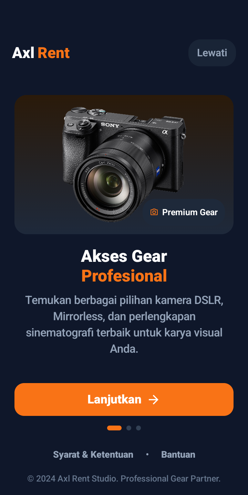</td>
      <td>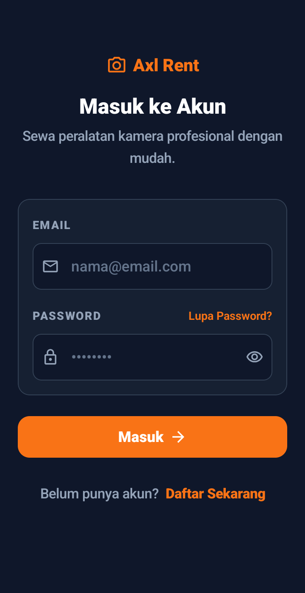</td>
      <td>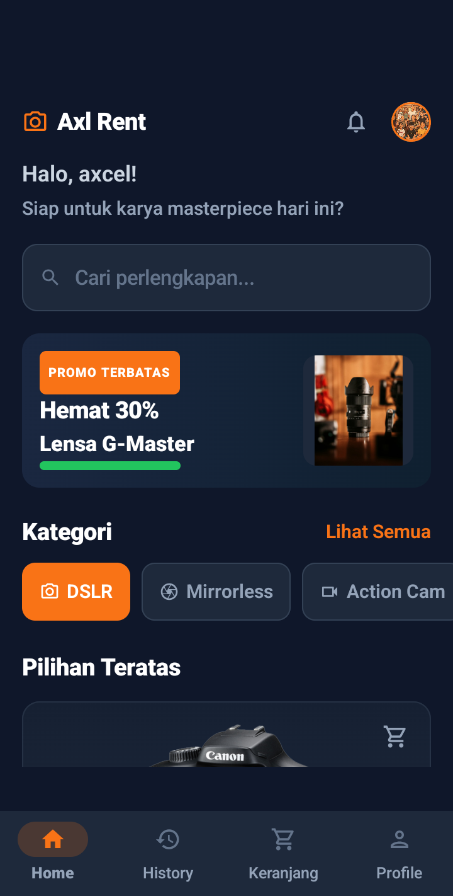</td>
    </tr>
  </table>
</div>

### 2. Alur Pemesanan, Transaksi & Keranjang
<div align="center">
  <table>
    <tr>
      <td align="center"><b>Detail Spesifikasi</b></td>
      <td align="center"><b>Formulir Booking</b></td>
      <td align="center"><b>Metode Pembayaran</b></td>
      <td align="center"><b>Keranjang Sewa</b></td>
    </tr>
    <tr>
      <td>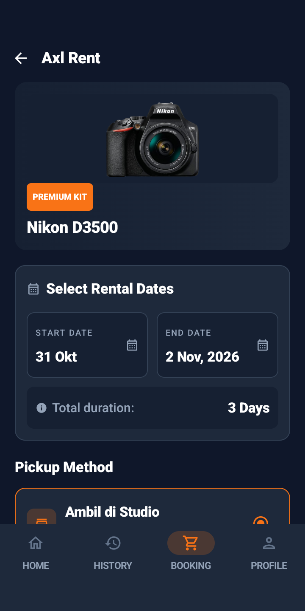</td>
      <td>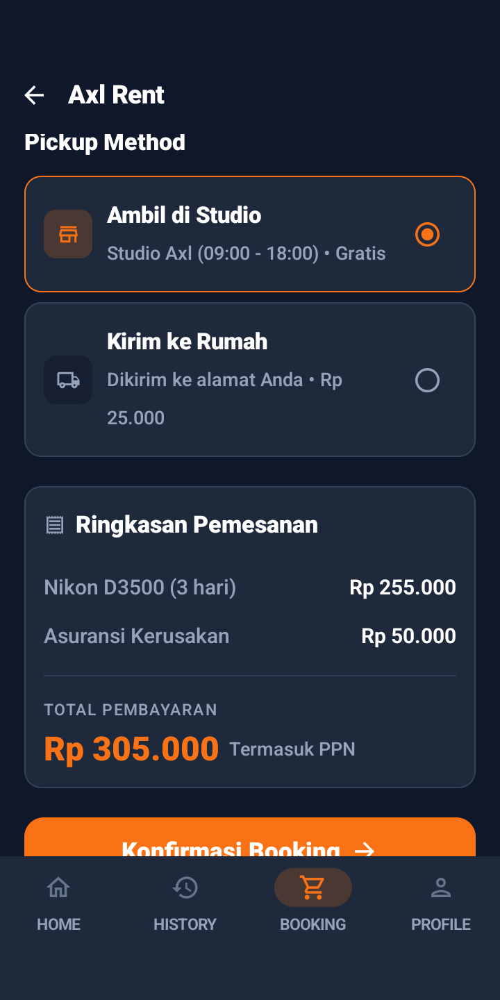</td>
      <td>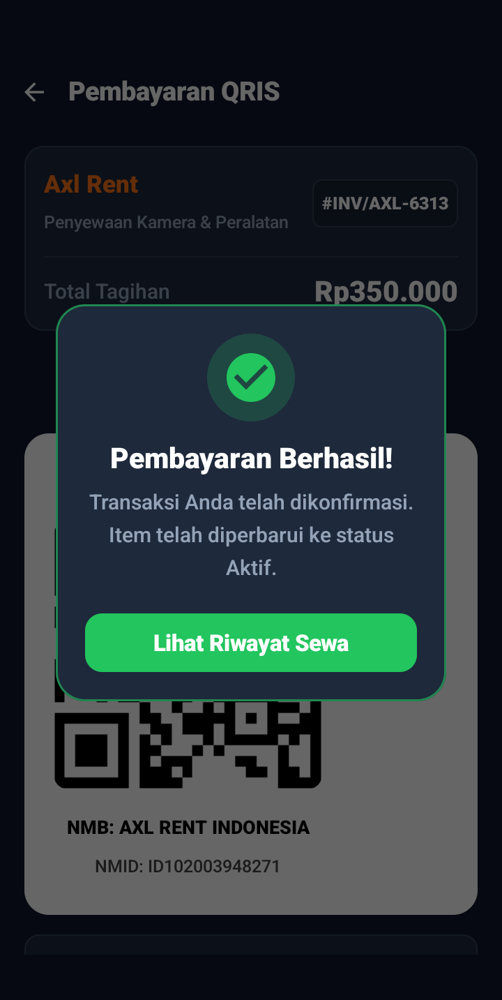</td>
      <td>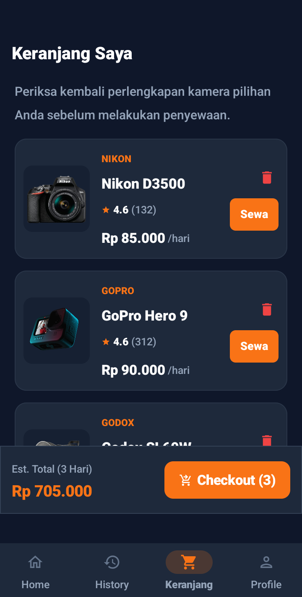</td>
    </tr>
  </table>
</div>

### 3. Aktivitas Pengguna & Akun
<div align="center">
  <table>
    <tr>
      <td align="center"><b>Riwayat Transaksi Sewa</b></td>
      <td align="center"><b>Profil Pengguna (Sinkronisasi Realtime)</b></td>
    </tr>
    <tr>
      <td>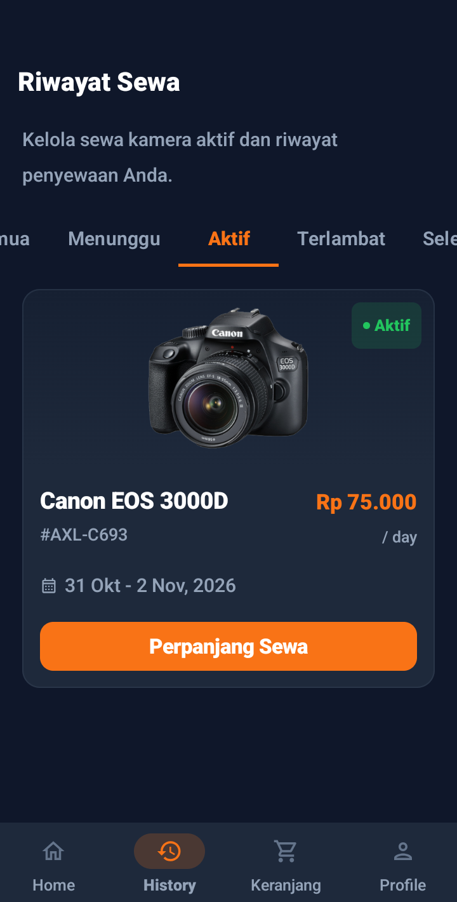</td>
      <td>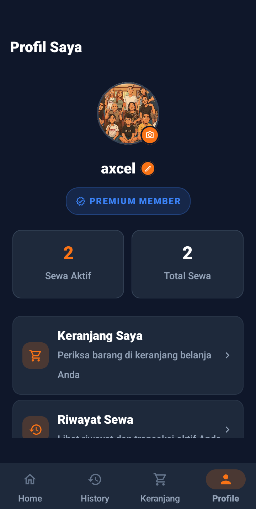</td>
    </tr>
  </table>
</div>

### 4. 🛡️ Panel Administrator (Admin Dashboard & Kontrol Stok)
<div align="center">
  <table>
    <tr>
      <td align="center"><b>Dashboard Monitoring & Verifikasi Pesanan</b></td>
      <td align="center"><b>Inventori & Manajemen Stok Fisik (+/-)</b></td>
    </tr>
    <tr>
      <td>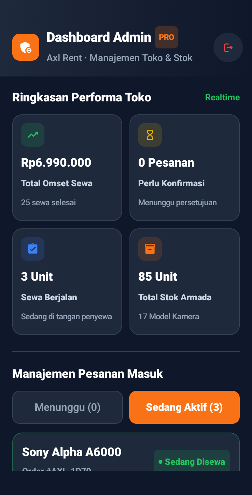</td>
      <td>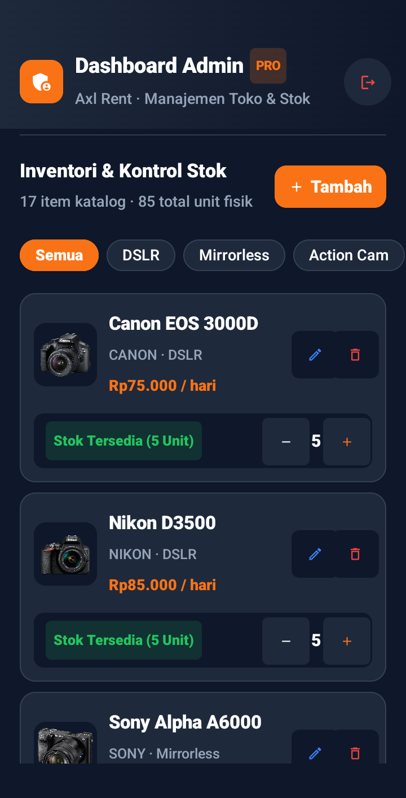</td>
    </tr>
  </table>
</div>

---

## ✨ Fitur Utama

* **🔐 Autentikasi Pengguna**: Registrasi akun baru, login dengan email/password, terintegrasi aman menggunakan **Firebase Authentication**.
* **🔍 Katalog & Pencarian Kamera**: Eksplorasi berbagai jenis kamera (DSLR, Mirrorless, Action Cam) lengkap dengan fitur pencarian dan filter kategori.
* **📋 Detail & Spesifikasi Lengkap**: Informasi mendalam seputar sensor kamera, resolusi, lensa bawaan, status ketersediaan unit, serta ulasan rating.
* **📅 Sistem Booking & Kalkulasi Otomatis**: Pemilihan durasi sewa, tanggal mulai dan selesai, dengan perhitungan biaya sewa harian otomatis.
* **💳 Simulasi Pembayaran & QRIS**: Pilihan metode pembayaran modern (Transfer Bank & QRIS) dengan konfirmasi pembayaran langsung.
* **📜 Riwayat Transaksi Realtime**: Pantau status sewa dan riwayat transaksi pengguna yang tersimpan di cloud database secara realtime.
* **👤 Manajemen Profil & Foto Profil Realtime**: Informasi akun pengguna, sinkronisasi foto avatar di beranda, serta ringkasan total sewa.
* **🛡️ Panel Administrator (Admin Dashboard & Manajemen Stok)**:
  * **Monitoring Finansial & Operasional**: Pantau total pendapatan rental (*Total Revenue*), pesanan menunggu konfirmasi, serta unit kamera yang sedang disewa.
  * **Kontrol Stok Kamera Realtime**: Manajemen jumlah stok fisik unit kamera dengan tombol *quick adjust* (+/-), indikator stok menipis, serta status stok habis otomatis.
  * **Verifikasi Pesanan Pelanggan**: Konfirmasi pembayaran sewa masuk dan pencatatan pengembalian unit sewa.
  * **Katalog CRUD Penuh**: Tambah armada baru, edit spesifikasi & harga harian, serta hapus barang dari inventori.

---

## 🛠️ Tech Stack & Arsitektur

* **Bahasa Pemrograman**: [Kotlin](https://kotlinlang.org/)
* **UI Framework**: [Jetpack Compose](https://developer.android.com/jetpack/compose) dengan [Material 3 Design System](https://m3.material.io/)
* **Arsitektur**: MVVM (Model-View-ViewModel) + StateFlow & Coroutines
* **Navigasi**: Navigation Compose (Single Activity Architecture)
* **Backend & Database**:
  * [Firebase Authentication](https://firebase.google.com/docs/auth) (Manajemen akun pengguna)
  * [Cloud Firestore](https://firebase.google.com/docs/firestore) (Database NoSQL realtime)
  * [Firebase Storage](https://firebase.google.com/docs/storage) (Penyimpanan gambar cloud)
* **Image Loading**: [Coil Compose](https://coil-kt.github.io/coil/compose/)

---

## 📂 Struktur Direktori

```text
Axl-Rent/
├── app/
│   ├── src/main/
│   │   ├── java/com/axlrent/
│   │   │   ├── data/            # Data models & sample data
│   │   │   ├── navigation/      # NavHost & rute navigasi aplikasi
│   │   │   ├── ui/
│   │   │   │   ├── screens/     # Layar Jetpack Compose (Home, Admin, Booking, Detail, dll)
│   │   │   │   └── theme/       # Desain tema, warna, dan tipografi
│   │   │   ├── viewmodel/       # State management & business logic
│   │   │   └── MainActivity.kt  # Entry point aplikasi
│   │   ├── res/                 # Resource gambar, ikon, dan strings
│   │   └── AndroidManifest.xml
│   ├── build.gradle.kts
│   └── google-services.json.example  # Template kredensial Firebase
├── screenshots/                 # Dokumentasi foto tampilan aplikasi terbaru
├── build.gradle.kts
├── settings.gradle.kts
└── README.md
```

---

## 🚀 Cara Menjalankan Project

### 1. Prasyarat
* Android Studio (Ladybug / Koala atau versi terbaru yang mendukung Kotlin 1.9+)
* JDK 17
* Akun Firebase (untuk database & autentikasi)

### 2. Kloning Repository
```bash
git clone https://github.com/axcel-vf/axl-rent.git
cd axl-rent
```

### 3. Konfigurasi Firebase
1. Buat project baru di [Firebase Console](https://console.firebase.google.com/).
2. Daftarkan aplikasi Android dengan package name: `com.axlrent`.
3. Aktifkan **Firebase Authentication** (Email/Password) dan **Cloud Firestore**.
4. Download file `google-services.json` dari Firebase Console.
5. Letakkan file tersebut di dalam folder `app/` (sejajar dengan file `google-services.json.example`).

### 4. Build dan Jalankan Aplikasi
1. Buka project di **Android Studio**.
2. Tunggu proses **Gradle Sync** selesai.
3. Hubungkan perangkat Android fisik (aktifkan *USB Debugging*) atau jalankan *Android Emulator*.
4. Klik tombol **Run 'app'** (`Shift + F10`).

---

## 💡 Apa yang Dipelajari & Tantangan Teknis

* **Adopsi Jetpack Compose Penuh**: Membangun antarmuka deklaratif dengan Material 3, mengelola State (`mutableStateOf`, `collectAsState`), dan transisi dinamis menggunakan Navigation Compose.
* **Integrasi Firebase Cloud Realtime**: Menghubungkan autentikasi pengguna secara aman dan menangani sinkronisasi data sewa serta stok kamera fisik secara realtime dengan Cloud Firestore.
* **Panel Role-Based Access Control (RBAC)**: Memisahkan tampilan dan hak akses antara pengguna umum dan akun administrator toko (`admin@axlrent.com`).
* **Keamanan Kredensial**: Menerapkan *best practice* keamanan dengan memisahkan file konfigurasi rahasia (`google-services.json`) menggunakan `.gitignore` serta menyediakan template `.example`.

---

## 👨‍💻 Pengembang

* **Nama**: Yhonatan Axcel Verdy Febrian
* **GitHub**: [@axcel-vf](https://github.com/axcel-vf)
* **Email**: yhonatanaksel3131@gmail.com
* **Project**: Pemrograman Mobile - Semester 6
